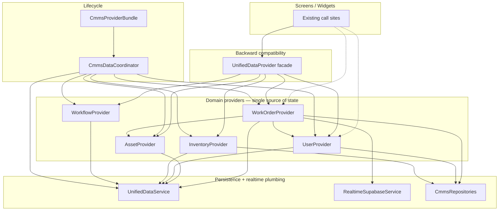

# Domain Provider Refactor

Split `UnifiedDataProvider` (~2,035 LOC god class) into five domain-owned providers with a coordinator and backward-compatible facade.

## Dependency Graph



### Provider ownership

| Provider | Owns | Realtime |
|----------|------|----------|
| `WorkOrderProvider` | Work orders, PM tasks, pagination, reference hydration | WO channel + PM stream |
| `AssetProvider` | Asset cache | Assets stream |
| `UserProvider` | User cache, user CRUD | Users stream |
| `InventoryProvider` | Inventory cache, CRUD, UI filters | Inventory stream |
| `WorkflowProvider` | Workflow cache, CRUD, approval actions | Workflows stream |

### ChangeNotifier forwarding

`CmmsProviderBundle` registers domain providers in `MultiProvider`. Domain changes propagate to legacy consumers via:

```
domain provider.notifyListeners()
  → bundle._forwardUnifiedNotify()
  → unified.notifyFromDomainChange()
  → UnifiedDataProvider.notifyListeners()
```

`WorkOrderProvider` listens to `UserProvider` + `AssetProvider` for `repopulateReferences()`.

---

## Refactor Plan (executed)

1. **Extract shared utilities** — dedupe + reference population (`providers/domain/`)
2. **Create domain providers** — one aggregate per provider, each implements `CmmsDomainProvider`
3. **Introduce `CmmsDataCoordinator`** — auth watch, initialize, refreshAll, sign-out cache clear
4. **Introduce `CmmsProviderBundle`** — wires dependencies, registers MultiProvider list
5. **Shrink `UnifiedDataProvider`** — pure delegation facade (~500 LOC)
6. **Update `BeElectricApp`** — single bundle instance, all providers registered
7. **Remove duplicate paths** — `InventoryProvider.setUnifiedDataProvider()` removed

---

## Files Changed / Created

### Created

- `providers/domain/domain_deduplication.dart`
- `providers/domain/domain_reference_populator.dart`
- `providers/domain/cmms_domain_provider.dart`
- `providers/work_order_provider.dart`
- `providers/asset_provider.dart`
- `providers/user_provider.dart`
- `providers/cmms_data_coordinator.dart`
- `providers/cmms_provider_bundle.dart`

### Refactored

- `providers/unified_data_provider.dart` — facade only
- `providers/inventory_provider.dart` — owns realtime inventory + CRUD
- `providers/workflow_provider.dart` — owns realtime workflows + record CRUD passthrough
- `app/be_electric_app.dart` — `CmmsProviderBundle` MultiProvider wiring
- `screens/inventory/inventory_list_screen.dart` — removed unified bridge
- `test/providers/unified_data_provider_test.dart` — uses `CmmsProviderBundle.forTesting()`

---

## Remaining Technical Debt

- `UnifiedDataService` still holds a secondary cache (dual-cache not eliminated at service layer)
- `WorkflowProvider` retains both permission/routing services and data cache (could split action vs data)
- PM tasks remain on `WorkOrderProvider` (matches repository aggregate)
- Most screens still consume `UnifiedDataProvider`; migrate incrementally to domain providers
- `UnifiedDataProvider.dispose()` disposes coordinator only — domain providers owned by bundle/app lifecycle

---

## Regression Checklist

### Auth & lifecycle

- [ ] Cold start: splash → login → dashboard loads without spinner stuck
- [ ] Login triggers data load (auth signedIn → coordinator.initialize)
- [ ] Logout clears caches and does not crash
- [ ] Token refresh does not reset data

### Work orders (realtime)

- [ ] Work order list shows seeded page on load
- [ ] Load-more pagination appends rows
- [ ] Realtime INSERT/UPDATE/DELETE updates list without duplicate tickets
- [ ] Create requestor work order (with photos) appears in Active tab
- [ ] Reopen completed work order moves to Active tab
- [ ] Technician assignment dialog updates assignees
- [ ] Work order detail hydrates fresh photos from server

### PM tasks

- [ ] PM task list realtime updates
- [ ] Create / complete PM task with completion photo
- [ ] Pause / resume PM task

### Users

- [ ] Admin user management: create, role change, delete
- [ ] Technician list populated for assignment dialogs

### Assets

- [ ] QR scanner resolves asset
- [ ] Requestor charger list loads by company

### Inventory

- [ ] Inventory list loads from realtime cache
- [ ] Create / adjust / delete inventory item

### Workflows

- [ ] Workflow list stream updates
- [ ] Approve / reject / escalate workflow

### Dashboard / analytics

- [ ] Dashboard stats match list counts
- [ ] Technician dashboard filters by assigned user
- [ ] Consolidated analytics dashboard loads KPIs

### Backward compatibility

- [ ] All existing `Provider.of<UnifiedDataProvider>` call sites compile and behave unchanged
- [ ] `Consumer<UnifiedDataProvider>` widgets rebuild on domain changes
- [ ] `flutter test` in `packages/cmms_core` passes
